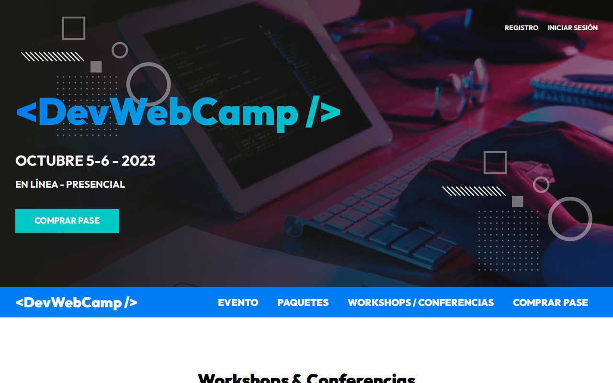
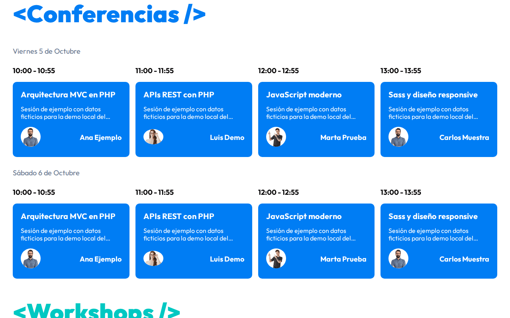
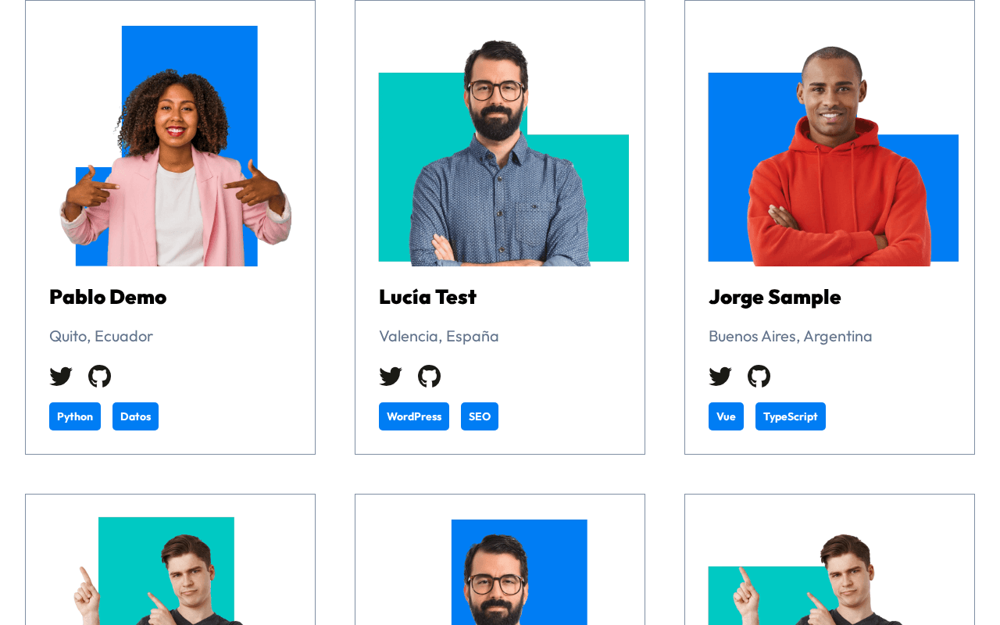
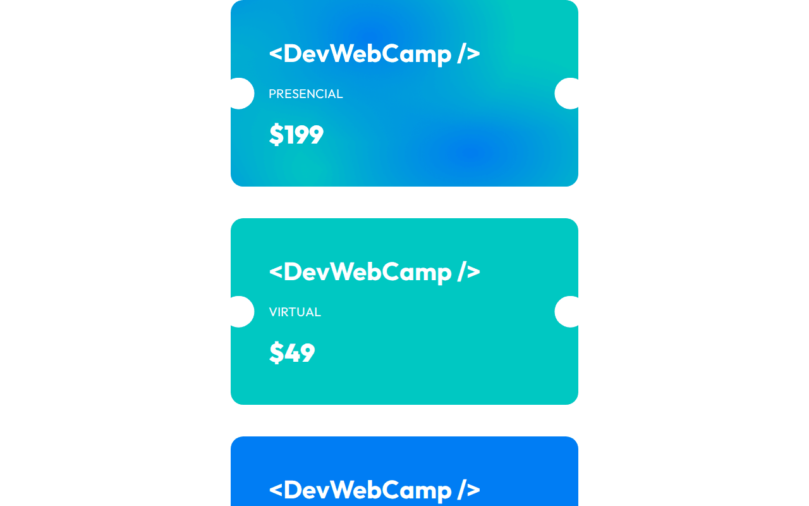
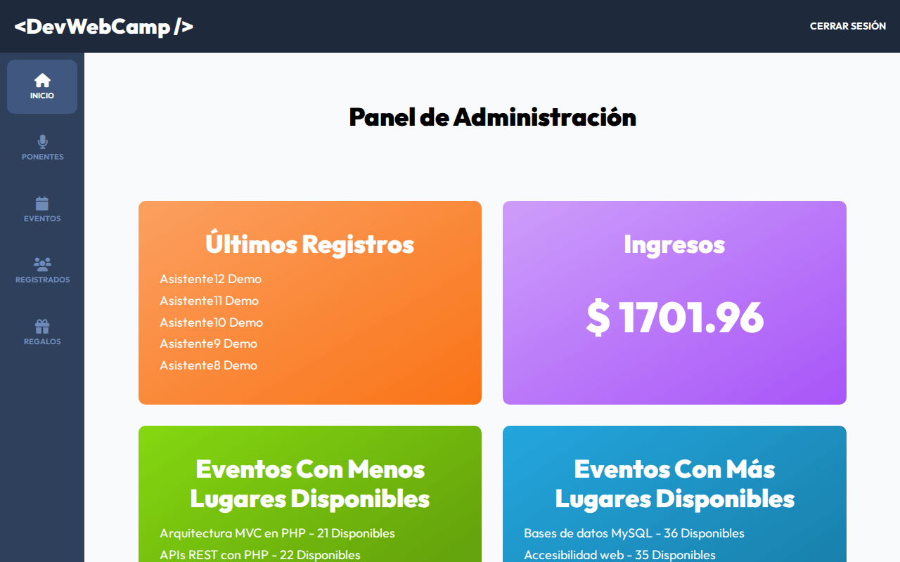
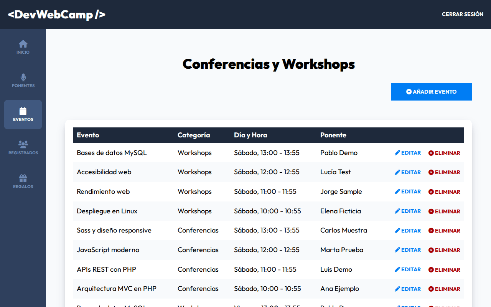

# DevWebCamp · Plataforma de eventos en PHP MVC

> **Proyecto de formación.** Proyecto final del curso *Desarrollo Web Completo* de
> Juan Pablo De la Torre Valdez ([Código Con Juan](https://codigoconjuan.com)).


Web de una conferencia para desarrolladores: agenda de conferencias y workshops,
ponentes, paquetes de entrada con pago y un panel de administración para gestionarlo
todo. Es el proyecto más completo del curso y reúne autenticación, CRUD, APIs JSON y
pagos.

## Funcionalidades

- **Público:** portada con agenda, ponentes y mapa (Leaflet), páginas de evento, paquetes y
  workshops/conferencias con slider (Swiper).
- **Cuentas:** registro con confirmación por email, login y recuperación de contraseña.
- **Registro al evento:** elección de paquete (presencial, virtual o gratis), pago con el SDK
  de PayPal, selección de conferencias con control de plazas, regalo y boleto virtual.
- **Panel de administración:** dashboard con últimos registros, ingresos y eventos con
  más/menos plazas; CRUD de ponentes (con subida y redimensionado de imagen) y de eventos;
  listado paginado de registrados y regalos.
- **APIs JSON:** `/api/eventos-horario`, `/api/ponentes`, `/api/ponente`, `/api/regalos`.

## Capturas

| Portada | Agenda |
|---|---|
|  |  |
| **Ponentes** | **Paquetes** |
|  |  |
| **Panel de administración** | **Gestión de eventos** |
|  |  |

*Capturas tomadas en local con datos de ejemplo ficticios.*

## Stack

- **Backend:** PHP 8 con MVC propio (router, `ActiveRecord` sobre mysqli), paginación propia.
- **Base de datos:** MySQL / MariaDB.
- **Frontend:** JavaScript sin frameworks empaquetado con webpack-stream, Sass con
  metodología BEM, Gulp (imágenes WebP y AVIF), Swiper, SweetAlert2, AOS y Leaflet.
- **Dependencias PHP:** `phpmailer/phpmailer`, `vlucas/phpdotenv`, `intervention/image`.

## Cómo ejecutarlo en local

Requisitos: PHP 8 con `mysqli` y `gd`, Composer y MySQL o MariaDB. `public/build/` ya está en
el repositorio, así que no hace falta compilar el frontend.

```bash
git clone git@github.com:ricardo-mendez-saoprojects/DevWebCamp.git
cd DevWebCamp
composer install
mysql -u <usuario> -p < docs/demo.sql         # crea devwebcamp_demo con datos de ejemplo
cp includes/.env.example includes/.env        # y rellena los valores
php -S localhost:3000 -t public
```

Abre `http://localhost:3000`. Panel de administración: `admin@demo.test` / `demo1234`.

- `docs/demo.sql` es un esquema **reconstruido a partir de `models/`** para poder probar la
  app; el repositorio original no incluía la base de datos.
- El pago usa el SDK de PayPal con un client-id escrito en `views/registro/crear.php`.
  Para probarlo pon el de tu propia app de PayPal (sandbox).
- Para recibir los correos en local basta un SMTP de pruebas como Mailpit o Mailtrap.
- El código usa interpolación `${var}`, obsoleta desde PHP 8.2: en PHP 8.2+ verás avisos
  de *deprecated* si `display_errors` está activo.
- Para recompilar Sass y JS: `npm install && npm run dev`.

## Estructura

```
├── classes/          Email (PHPMailer) y Paginacion
├── controllers/      Auth, Paginas, Registro, Dashboard, Ponentes, Eventos,
│                     Registrados, Regalos y API* (JSON)
├── includes/         app.php (arranque), database.php, funciones.php, .env
├── models/           ActiveRecord y un modelo por tabla
├── public/           index.php (rutas) y build/ (CSS, JS e imágenes compilados)
├── src/              js/, scss/ e img/ de origen
├── views/            paginas/, auth/, registro/, admin/ y templates/
├── Router.php        router propio
└── gulpfile.js
```

## Créditos

Proyecto final del curso *Desarrollo Web Completo* de Juan Pablo De la Torre Valdez
([Código Con Juan](https://codigoconjuan.com)). El planteamiento, el diseño y las imágenes de
ponentes son del curso; la implementación es mía. Sobre esta base construí
[DevClubDeportivo](https://github.com/ricardo-mendez-saoprojects/DevClubDeportivo).

<details>
<summary><strong>English</strong></summary>

# DevWebCamp · Event platform in PHP MVC

> **Learning project.** Final project of the *Desarrollo Web Completo* course by
> Juan Pablo De la Torre Valdez ([Código Con Juan](https://codigoconjuan.com)).

Website for a developer conference: a schedule of talks and workshops, speakers, ticket
packages with online payment and an admin panel to manage it all. It is the most complete
project of the course and combines authentication, CRUD, JSON APIs and payments.

## Features

- **Public site:** home page with schedule, speakers and a map (Leaflet), event, packages
  and talks/workshops pages with a slider (Swiper).
- **Accounts:** sign-up with email confirmation, login and password reset.
- **Event registration:** package choice (on-site, virtual or free), payment through the
  PayPal SDK, talk selection with seat limits, a gift and a virtual ticket.
- **Admin panel:** dashboard with latest registrations, revenue and events with the most/fewest
  seats left; CRUD for speakers (with image upload and resizing) and events; paginated list of
  attendees and gifts.
- **JSON APIs:** `/api/eventos-horario`, `/api/ponentes`, `/api/ponente`, `/api/regalos`.

## Screenshots

See the table above (local run with fictitious sample data).

## Stack

- **Backend:** PHP 8 with a custom MVC (router, `ActiveRecord` on top of mysqli) and pagination.
- **Database:** MySQL / MariaDB.
- **Frontend:** vanilla JavaScript bundled with webpack-stream, Sass with BEM, Gulp (WebP and
  AVIF images), Swiper, SweetAlert2, AOS and Leaflet.
- **PHP dependencies:** `phpmailer/phpmailer`, `vlucas/phpdotenv`, `intervention/image`.

## Running locally

Requirements: PHP 8 with `mysqli` and `gd`, Composer and MySQL or MariaDB. `public/build/` is
committed, so no frontend build is needed.

```bash
git clone git@github.com:ricardo-mendez-saoprojects/DevWebCamp.git
cd DevWebCamp
composer install
mysql -u <user> -p < docs/demo.sql            # creates devwebcamp_demo with sample data
cp includes/.env.example includes/.env        # then fill in the values
php -S localhost:3000 -t public
```

Open `http://localhost:3000`. Admin panel: `admin@demo.test` / `demo1234`.

- `docs/demo.sql` is a schema **rebuilt from `models/`** so the app can be tried out; the
  original repository did not ship the database.
- Payments use the PayPal SDK with a client-id hard-coded in `views/registro/crear.php`.
  Replace it with your own PayPal app's (sandbox) client-id to test it.
- Any test SMTP server (Mailpit, Mailtrap) will catch the emails locally.
- The code uses `${var}` string interpolation, deprecated since PHP 8.2: expect
  deprecation notices on PHP 8.2+ if `display_errors` is on.
- To rebuild Sass and JS: `npm install && npm run dev`.

## Structure

See the tree above: `controllers/` (including JSON `API*` controllers), `models/`, `views/`,
`classes/`, `public/` (front controller and compiled assets), `src/` and a custom `Router.php`.

## Credits

Final project of the *Desarrollo Web Completo* course by Juan Pablo De la Torre Valdez
([Código Con Juan](https://codigoconjuan.com)). Concept, design and speaker images come from
the course; the implementation is mine. I later built
[DevClubDeportivo](https://github.com/ricardo-mendez-saoprojects/DevClubDeportivo) on top of it.

</details>
